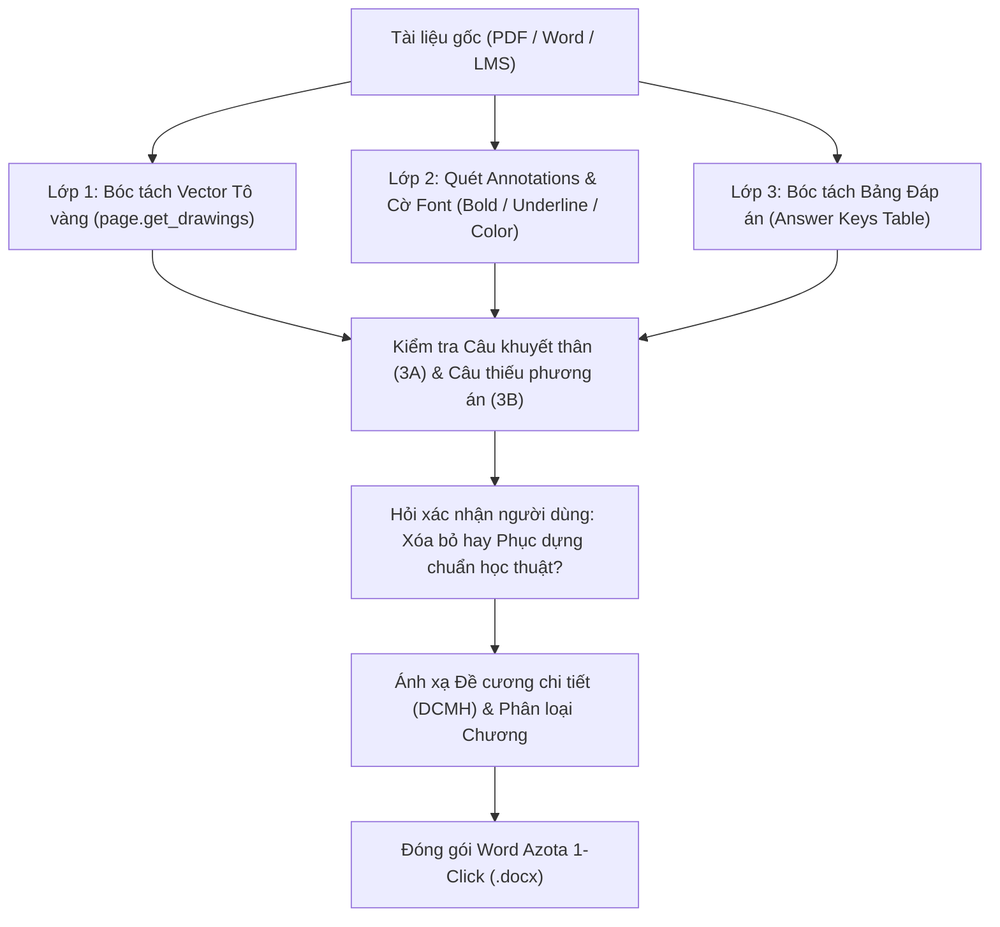

# 📄 EXAM DIGITIZER (v2.1)
> **Academic Exam Digitization, Verbatim Standardization & 1-Click Azota Packaging Engine**

[](https://github.com/trungnt2006/exam-digitizer.git)
[](CHANGELOG.md)
[](#hệ-thống-5-quy-tắc-thép-bất-biến)

**Exam Digitizer** là bộ kỹ năng chuyên sâu chịu trách nhiệm **chuyển đổi, chuẩn hóa và làm sạch 100% các ngân hàng đề thi trắc nghiệm có sẵn** (PDF scan, PDF Studocu, đề LMS, file Word thô từ ngân hàng câu hỏi của trường) sang file Word chuẩn **Azota 1-Click**.

Khác hoàn toàn với kỹ năng sáng tác đề mới (*Exam Architect*), Digitizer tuyệt đối **không tự ý sáng tác câu chữ**, mà tập trung bảo toàn vẹn toàn nguyên bản đề thi, đối soát đáp án đa tầng và xây dựng hệ thống giải thích học thuật có trích dẫn nguồn gốc rõ ràng.

---

## ⚡ HỆ THỐNG 5 QUY TẮC THÉP BẤT BIẾN (CORE INTEGRITY RULES)

1. **Nguyên văn 100% câu từ (Verbatim Stem & Options):**
   - Thân câu hỏi và 4 phương án lựa chọn giữ nguyên 100% từng chữ, thuật ngữ, dấu câu từ file gốc.
   - Tuyệt đối không tự ý viết lại văn phong, không thêm chú thích / dịch tiếng Anh vào câu hỏi hoặc phương án. Mọi phân tích phải đưa xuống phần `Lời giải:`.
2. **Tôn trọng đáp án gốc & Phân bổ đều ~25%:**
   - Nội dung phương án đúng được chọn phải phản ánh chính xác 100% đáp án gốc.
   - Cho phép hoán vị vị trí A/B/C/D để đạt tỷ lệ ~25% mỗi ký tự (chống đoán mò trên Azota).
3. **Xử lý các ca câu hỏi bất thường (Bắt buộc hỏi xác nhận người dùng):**
   - **3A. Câu khuyết thân câu, chỉ có đáp án/phương án (Missing Stem / Answer-Only):** Bắt buộc dừng lại báo cáo số lượng + ví dụ và hỏi người dùng:
     - *Nếu chọn "KHÔNG":* Xóa bỏ hoàn toàn và đánh lại số thứ tự liên tục `Câu 1, 2, 3...`.
     - *Nếu chọn "CÓ":* Dựa vào nội dung đáp án đúng (và phương án nhiễu nếu có), đối chiếu Slide/Giáo trình để **phục dựng lại thân câu hỏi chuẩn học thuật** khớp 100% với đáp án gốc.
   - **3B. Câu thiếu phương án (Flashcard / Tự luận ngắn):** Bắt buộc dừng lại xác nhận với người dùng:
     - *Nếu chọn "KHÔNG":* Xóa bỏ khỏi file trắc nghiệm.
     - *Nếu chọn "CÓ":* Sinh thêm 3 phương án nhiễu cùng họ (Sibling Concepts) đạt chuẩn 4 lựa chọn A, B, C, D.
4. **Cấm âm thầm sửa đáp án (Report First, Edit Later):**
   - Khi phát hiện đề gốc khoanh sai hoặc gây tranh cãi, bắt buộc xuất Báo cáo Hiệu đính kèm trích dẫn đối soát Giáo trình/Slide. Chỉ sửa khi người dùng phê duyệt.
5. **Cấu trúc Lời giải chuẩn 4 phần:**
   - Dòng chọn đáp án -> Bản chất lý thuyết -> Phân tích bẫy thi & phương án nhiễu -> Dòng Metadata trích dẫn (`📌 Nguồn: ...`).

---

## 🛠️ QUY TRÌNH BÓC TÁCH KỸ THUẬT ĐA TẦNG (DEEP EXTRACTION ENGINE)



---

## 🛠️ CẤU TRÚC DỰ ÁN

```text
exam-digitizer/
├── SKILL.md                          # Định nghĩa Skill chính thức cho Agent
├── AGENTS.md                         # File luật nạp tự động cho OpenCode / Antigravity / Cursor
├── README.md                         # Tài liệu hướng dẫn sử dụng
├── CHANGELOG.md                      # Lịch sử nâng cấp phiên bản
├── LICENSE                           # Giấy phép mã nguồn mở MIT
└── scripts/
    ├── pdf_extractor.py              # Động cơ bóc tách PDF đa tầng (Yellow rects, bold, tables)
    ├── azota_formatter.py            # Động cơ tạo file Word Azota 1-Click chuẩn quy cách
    └── digitizer_auditor.py          # Bộ kiểm định chất lượng số hóa (Độ toàn vẹn, phát hiện câu khuyết thân/phương án)
```

---

## 🚀 HƯỚNG DẪN CÀI ĐẶT

### Dành cho Antigravity / Gemini CLI:
Copy thư mục `exam-digitizer` vào:
- `~/.gemini/config/skills/exam-digitizer` (Global)
- Hoặc `.agents/skills/exam-digitizer` (Workspace dự án)

### Dành cho OpenCode / Cursor:
Đặt file `AGENTS.md` tại thư mục môn học. Agent sẽ tự động nạp toàn bộ luật và quy trình của Exam Digitizer.

---

## 📄 LICENSE
Phát triển bởi **Trung Ngo** phục vụ cộng đồng sinh viên Đại học Ngân hàng TP.HCM (HUB) và người học theo tiêu chuẩn khảo thí đại học.  
Mã nguồn mở theo giấy phép MIT.
