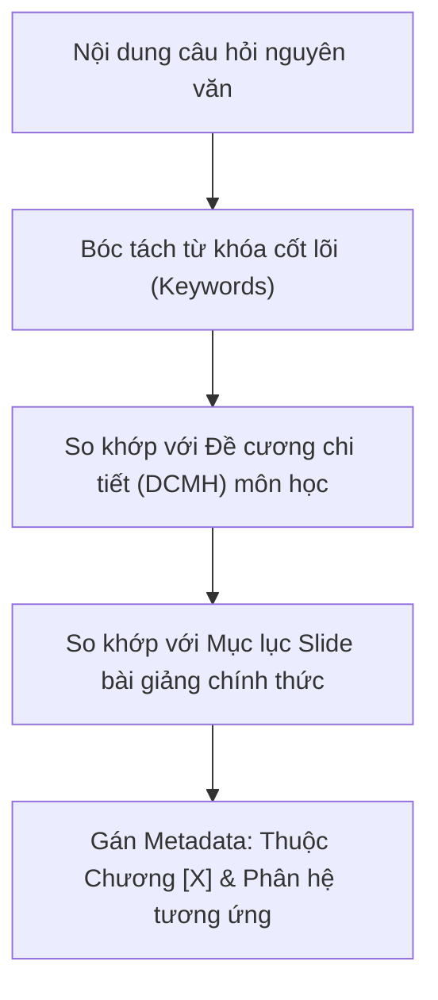

# EXAM DIGITIZER v2.1 — CẨM NANG CHI TIẾT SỐ HÓA & CHUẨN HÓA NGÂN HÀNG ĐỀ THI TRẮC NGHIỆM (.DOCX AZOTA 1-CLICK)

**Exam Digitizer** là bộ kỹ năng chuyên sâu độc lập chịu trách nhiệm **chuyển đổi, chuẩn hóa và làm sạch 100% các ngân hàng đề thi trắc nghiệm có sẵn** (PDF scan, PDF Studocu, đề LMS, file Word thô từ ngân hàng câu hỏi của trường) sang file Word chuẩn **Azota 1-Click**.

Khác hoàn toàn với kỹ năng sáng tác đề mới (*Exam Architect*), Digitizer tuyệt đối **không tự ý sáng tác câu chữ**, mà tập trung bảo toàn trọn vẹn nguyên bản đề thi, đối soát đáp án đa tầng và xây dựng hệ thống giải thích học thuật có trích dẫn nguồn gốc rõ ràng.

---

## ⚡ HỆ THỐNG 5 QUY TẮC THÉP BẤT BIẾN (CORE INTEGRITY RULES)

### 1. NGUYÊN TẮC BẤT KHẢ XÂM PHẠM: NGUYÊN VĂN 100% CÂU TỪ (VERBATIM STEM & OPTIONS)
- **Bảo toàn nguyên bản:** Thân câu hỏi và 4 phương án lựa chọn phải giữ nguyên vẹn 100% từng chữ, từng câu, thuật ngữ và dấu câu từ file gốc của trường.
- **TUYỆT ĐỐI CẤM:**
  - Không tự ý viết lại văn phong cho "mượt mà", "học thuật" hay "rõ nghĩa hơn".
  - Không thêm bớt từ ngữ, không tự ý chèn chú thích, mở ngoặc giải thích thuật ngữ hoặc dịch nghĩa tiếng Anh vào thân câu và phương án.
  - *Ví dụ sai phạm:* Đề gốc ghi *"A. BRD"*, Agent tự ý sửa thành *"A. BRD (Business Requirements Document)"* $\rightarrow$ **CẤM TUYỆT ĐỐI**. Mọi giải nghĩa phải đưa xuống phần `Lời giải:`.

### 2. TÔN TRỌNG ĐÁP ÁN GỐC & CƠ CHẾ HOÁN VỊ PHÂN BỔ ĐÁP ÁN
- **Trung thành với nội dung đúng:** Phương án đúng được chọn phải phản ánh chính xác 100% nội dung đáp án được khoanh/tô màu (highlight) trong file gốc của tác giả.
- **Cơ chế hoán vị phân bổ đều ~25%:** Cho phép hoán vị ngẫu nhiên vị trí các phương án A, B, C, D để đạt tỷ lệ phân bổ đều ~25% cho mỗi chữ cái (chuẩn Azota 1-Click chống đoán mò), miễn là phương án đúng được gạch chân in đậm `<u><b>X.</b></u>` tương ứng chính xác với nội dung đáp án đúng của đề gốc.

### 3. XỬ LÝ CÁC DẠNG CÂU HỎI BẤT THƯỜNG (BẮT BUỘC HỎI Ý KIẾN NGƯỜI DÙNG TRƯỚC)

#### 3A. XỬ LÝ CÂU HỎI KHUYẾT THÂN CÂU, CHỈ CÓ ĐÁP ÁN / PHƯƠNG ÁN (MISSING STEM / ANSWER-ONLY)
Khi quét tài liệu và phát hiện các câu bị mất/khuyết phần câu hỏi mở đầu mà chỉ có phần đáp án hoặc các phương án lựa chọn (do lỗi cắt trang PDF, lỗi copy hoặc ghi chú thiếu của đề gốc):
- **BẮT BUỘC DỪNG LẠI XÁC NHẬN VỚI NGƯỜI DÙNG:** Báo cáo rõ số lượng, vị trí câu và trích dẫn nội dung đáp án đang có, sau đó hỏi:  
  👉 *"Trong file có [X] câu bị khuyết nội dung câu hỏi và chỉ có phần đáp án (ví dụ Câu [Y]: '...'). Phần này bác có muốn phục dựng lại thân câu hỏi chuẩn học thuật không, hay xóa bỏ ạ?"*
- **NẾU NGƯỜI DÙNG BẢO "KHÔNG" (XÓA):** Loại bỏ hoàn toàn các câu khuyết này khỏi đề thi và đánh lại số thứ tự liên tục (`Câu 1, 2, 3...`).
- **NẾU NGƯỜI DÙNG BẢO "CÓ" (PHỤC DỰNG):** Agent căn cứ vào nội dung đáp án đúng (và các phương án nhiễu còn lại), đối chiếu ngược với Slide bài giảng và Giáo trình của môn học để **phục dựng lại thân câu hỏi (Question Stem) chuẩn học thuật**, đảm bảo câu hỏi khớp logic 100% với đáp án gốc (và bổ sung đủ 4 phương án Sibling Concepts nếu câu đó mới chỉ có 1 đáp án đơn lẻ).

#### 3B. XỬ LÝ CÂU HỎI THIẾU PHƯƠNG ÁN (FLASHCARD / TỰ LUẬN / CÂU HỎI NGẮN)
Khi quét tài liệu và phát hiện các câu chỉ có Câu hỏi và 1 Đáp án đúng (hoặc câu hỏi tự luận ngắn/tóm tắt lý thuyết):
- **BẮT BUỘC DỪNG LẠI XÁC NHẬN VỚI NGƯỜI DÙNG:** Báo cáo rõ trong file có nhóm câu này (kèm số lượng, ví dụ cụ thể) và hỏi:  
  👉 *"Trong file có [X] câu chỉ có câu hỏi và đáp án đúng (dạng tự luận/flashcard). Phần này bác có cần làm thành trắc nghiệm 4 lựa chọn không ạ?"*
- **NẾU NGƯỜI DÙNG BẢO "KHÔNG":** Bỏ qua hoàn toàn, tuyệt đối không đưa vào file trắc nghiệm.
- **NẾU NGƯỜI DÙNG BẢO "CÓ":** Lúc đó Agent mới được phép tự sinh thêm 3 phương án sai (distractors) cùng họ (Sibling Concepts), đảm bảo chuẩn 4 lựa chọn A, B, C, D có lời giải chi tiết.

### 4. CẤM ÂM THẦM SỬA ĐÁP ÁN (REPORT FIRST, EDIT LATER)
- Khi phát hiện một câu trong đề gốc bị khoanh sai kiến thức hoặc gây tranh cãi chuyên môn: **BẮT BUỘC DỪNG LẠI**, hiển thị Báo cáo Hiệu đính trực tiếp trong chat chỉ rõ:
  1. Đáp án cũ trong file gốc của trường.
  2. Đáp án mới chuẩn xác theo học thuật.
  3. Lý do & Trích dẫn bằng chứng nguyên văn từ Giáo trình (tên sách, chương, trang) hoặc Slide bài giảng của trường.
- **CHỈ KHI NGƯỜI DÙNG PHÊ DUYỆT ĐỒNG Ý MỚI ĐƯỢC PHÉP SỬA VÀO FILE WORD!**

### 5. TOÀN BỘ PHÂN TÍCH CHUYÊN MÔN CHỈ NẰM Ở MỤC LỜI GIẢI
- Mọi phân tích chuyên sâu, dịch thuật ngữ tiếng Anh, trích dẫn tài liệu hay cảnh báo bẫy thi **CHỈ ĐƯỢC PHÉP NẰM TRONG KHỐI `Lời giải:`**, tuyệt đối không xâm phạm vào vùng câu hỏi thi.

---

## 🗂️ PHƯƠNG PHÁP LUẬN PHÂN LOẠI CHƯƠNG & CHỦ ĐỀ CON (CHAPTER & TOPIC CLASSIFICATION)

Khi số hóa một đề thi tổng hợp (như *Final Exam*, *Đề ôn tập tổng hợp 100 câu*), Agent không được gán chương bừa bãi mà phải phân loại dựa trên **Hệ thống Ma trận Ánh xạ (Topic Mapping Matrix)** chuẩn của môn học:



### 1. Căn cứ Phân loại Chương:
1. **Đề cương môn học (DCMH) chính thức của HUB:** Cấu trúc số tiết, tên chương và chuẩn đầu ra (CLOs) của từng chương.
2. **Mục lục Slide bài giảng của Giảng viên:** Cách phân chia tuần học và chuyên đề thực tế trên lớp.
3. **Mục lục Giáo trình chuẩn quốc tế:** Đối chiếu với các chương trong sách giáo trình gốc.

### 2. Bảng Ma trận Ánh xạ Từ khóa cho Môn ERP (Ví dụ mẫu tại HUB):
- **Chương 1: Tổng quan về Hệ thống Hoạch định Nguồn lực Doanh nghiệp (ERP)**
  - *Từ khóa nhận diện:* Enterprise System, Lịch sử ERP, Y2K, Kiến trúc tích hợp (Integrated System), Functional vs Process, Lợi ích/Hạn chế ERP, Chi phí triển khai (TCO), ERP vendor (SAP, Oracle, Microsoft Dynamics).
- **Chương 2: Dữ liệu và Kiến trúc Hệ thống ERP**
  - *Từ khóa nhận diện:* Organizational Data (Client, Company Code, Plant, Storage Location), Master Data (Material Master, Vendor, Customer), Transaction Data, Document Flow, 3-tier Architecture.
- **Chương 3: Quy trình Mua hàng (Procurement Process / Procure-to-Pay - MM)**
  - *Từ khóa nhận diện:* Purchase Requisition (PR), Purchase Order (PO), Goods Receipt (GR), Invoice Verification, Three-way Match, Tài khoản trung gian GR/IR, Vendor Master, Raw Material (ROH).
- **Chương 4: Quy trình Bán hàng & Phân phối (Fulfillment Process / Order-to-Cash - SD)**
  - *Từ khóa nhận diện:* Pre-sales (Inquiry, Quotation), Sales Order (SO), Schedule Lines, Item Conditions, Shipping (Pick, Pack, Post Goods Issue - PGI), Billing Due List, Invoice, Open Item, Customer Master, Trading Goods (HAWA).
- **Chương 5: Quy trình Quản lý Sản xuất (Production Process - PP)**
  - *Từ khóa nhận diện:* Bill of Materials (BOM), Routing, Work Center, Planned Order, Production Order, Make-to-Stock (MTS), Make-to-Order (MTO), Semi-finished Goods (HALB), Finished Goods (FERT), Goods Issue cho sản xuất.
- **Chương 6: Quy trình Kế toán & Quản lý Tài chính (FI/CO)**
  - *Từ khóa nhận diện:* Financial Accounting (FI), Managerial Accounting / Controlling (CO), General Ledger (GL), Sub-ledger, Reconciliation Account, Balance Sheet, Income Statement, Cost Center, Activity-Based Costing (ABC).
- **Chương 7: Triển khai Hệ thống ERP & Phân tích Nghiệp vụ (ERP Implementation & BA)**
  - *Từ khóa nhận diện:* Vòng đời dự án ERP, Change Management, GAP Analysis, Business Process Reengineering (BPR), Best Practices, Phân tích bên liên quan (BABOK), Elicitation, BRD, SRS, Test case.

---

## 📚 THỨ BẬC NGUỒN DẪN CHỨNG & CẤU TRÚC LỜI GIẢI HỌC THUẬT

### 1. Thứ bậc Ưu tiên Nguồn Tri thức (Citation Hierarchy)
Khi viết giải thích cho từng câu hỏi, Agent bắt buộc tuân theo thứ bậc 3 tầng để đảm bảo tính khách quan và thẩm quyền học thuật:

$$\text{Slide bài giảng của GV trực tiếp dạy} \ge \text{Giáo trình chính (Textbook quốc tế)} > \text{Tài liệu kỹ thuật chính thức (SAP/BABOK)} > \text{Tài liệu mạng}$$

1. **Nguồn 1 — Slide bài giảng của Giảng viên HUB:**
   - Dùng để đồng bộ **thuật ngữ chấm thi của trường** (cách thầy cô dịch tiếng Anh sang tiếng Việt, các ví dụ giảng viên nhấn mạnh trên lớp như công ty Fitter Snacker, sữa Vinamilk, công ty xe đạp GBI).
   - *Định dạng trích dẫn:* `Slide [Tên phân hệ / Bài giảng], Buổi [X], Khoa HTTTQL - HUB`.
2. **Nguồn 2 — Giáo trình chuẩn quốc tế (Textbook - Nền tảng chân lý):**
   - Dùng để giải thích bản chất kỹ thuật sâu sắc, định khoản kế toán, công thức tính toán và giải mã bẫy thi.
   - Sách chuẩn môn ERP: *Concepts in Enterprise Resource Planning (4th Edition) — Ellen Monk & Bret Wagner (Cengage Learning, 2013)*.
   - Sách chuẩn môn Phân tích nghiệp vụ: *A Guide to the Business Analysis Body of Knowledge (BABOK Guide v3) — IIBA*.
   - *Định dạng trích dẫn:* `Monk & Wagner (2013), Ch. [X], Trang [Y]`.
3. **Nguồn 3 — Tài liệu kỹ thuật chính hãng (SAP Help Portal / Best Practices):**
   - Dùng để xác thực các Transaction Code (T-code), bảng dữ liệu (Table), quy ước định khoản (Posting Keys) và logic xử lý hệ thống của SAP ECC / SAP S/4HANA.

---

### 2. Cấu trúc Giải phẫu Chuẩn của một Khối Lời giải (Explanation Anatomy)

Mỗi câu hỏi số hóa xuất ra file Word Azota bắt buộc phải có khối lời giải theo cấu trúc 4 phần chuẩn mực:

```text
Lời giải:
Chọn [X].
[1. BẢN CHẤT LÝ THUYẾT]: Giải thích rõ ràng nguyên lý tại sao phương án [X] là đáp án đúng theo quy trình nghiệp vụ hoặc cơ chế kỹ thuật của hệ thống.
[2. PHÂN TÍCH BẪY THI & PHƯƠNG ÁN NHIỄU]: Giải thích vì sao các phương án còn lại là sai (chỉ ra từ khóa sai bản chất, hoặc đó là thuật ngữ thuộc phân hệ/quy trình nào khác để người học không bị nhầm lẫn).
📌 Nguồn: [Tên Slide hoặc Tên Sách], Chương [X], Trang [Y] | Mức độ: [Bloom 1-3] | Phân hệ/Chương: [Tên phân hệ]
```

*Ví dụ minh họa Lời giải chuẩn của Exam Digitizer:*
> **Lời giải:**  
> **Chọn B.**  
> - **Bản chất lý thuyết:** Theo phân hệ SAP SD, sau khi quá trình xuất hàng thành công (Post Goods Issue - PGI), chứng từ vận chuyển Outbound Delivery hoàn tất nhiệm vụ vật lý và được hệ thống tự động đẩy sang Danh sách chờ lập hóa đơn (Billing Due List). Bộ phận kế toán sẽ dựa vào danh sách này để tạo Hóa đơn (Invoice) đòi tiền khách hàng.  
> - **Phân tích bẫy thi:** Phương án A (Open items list) là danh sách hóa đơn chưa thanh toán trong kế toán FI; C và D chỉ là các báo cáo danh sách tĩnh, không phải là bước chuyển tiếp nghiệp vụ tự động tiếp theo.  
> 📌 *Nguồn: Slide Quy trình Xuất hàng SD, HUB & Monk & Wagner (2013), Ch. 2, Trang 48 | Mức độ: Thông hiểu (Bloom 2) | Phân hệ: SD/MM*

---

## 🛠️ QUY TRÌNH BÓC TÁCH KỸ THUẬT ĐA TẦNG (DEEP EXTRACTION ENGINE)

Khi xử lý các file PDF/Word từ nguồn bên ngoài (Studocu, LMS, Test Bank), script Python phải thực hiện trích xuất theo cơ chế 3 lớp:

1. **Lớp 1 — Trích xuất Hình chữ nhật Tô vàng (Yellow Vector Fill):**
   - Sử dụng thư viện `pymupdf` (fitz) quét qua `page.get_drawings()`.
   - Bắt các đối tượng có màu fill vàng: `r > 0.7, g > 0.7, b < 0.4` (mã màu vàng `(1.0, 1.0, 0.0)` hoặc vàng cam nhạt).
   - Ghép các ô hình chữ nhật nằm liền kề trên cùng một dòng để lấy trọn vẹn văn bản đáp án được tô màu.
2. **Lớp 2 — Trích xuất Annotations & Thuộc tính Font (Bold/Underline):**
   - Quét qua `page.annots()` tìm các annotation loại Highlight (Type 8).
   - Quét qua `page.get_text("dict")` bắt các span chữ có cờ `flags & 2 != 0` (in đậm) hoặc `color != 0` (chữ màu đỏ/xanh biểu thị đáp án).
3. **Lớp 3 — Chuẩn hóa Ký tự & Lọc sạch Watermark:**
   - Tự động lọc bỏ các dòng rác của bên thứ ba: `Studocu is not sponsored`, `Downloaded by`, mã tài liệu `lOMoARcPSD`, số trang Studocu.
   - Giữ nguyên cấu trúc thụt đầu dòng và các danh sách liệt kê `(1), (2), (3)...`.

---

## 📄 QUY CHUẨN ĐÓNG GÓI XUẤT BẢN AZOTA 1-CLICK (.DOCX)

- **Căn lề chuẩn trang:** Top: 2cm, Bottom: 2cm, Left: 2cm, Right: 2cm.
- **Tiêu đề câu:** `Câu X: [Nội dung nguyên văn]` (in đậm chữ `Câu X: `, cỡ chữ 11pt, Times New Roman).
- **Phương án lựa chọn:**
  - `A. `, `B. `, `C. `, `D. ` (thụt lề trái 0.2 inch, giãn dòng 1.15).
  - Phương án đúng: **Gạch chân và in đậm chữ cái phương án** (`<u><b>A.</b></u>`).
- **Khối Lời giải:**
  - Tiêu đề `Lời giải:` in đậm màu xanh lá (`#006600`).
  - Dòng chọn: `Chọn X.` in đậm.
  - Dòng Metadata bắt đầu bằng `📌 ` in nghiêng, màu xám (`#555555`).
- **Kết thúc tài liệu:** Dòng chữ **`HẾT`** in đậm, căn giữa, cỡ chữ 14pt.
- **Tên file xuất bản quy định:**  
  `Azota/[Tên_file_gốc] - azota.docx` (BẮT BUỘC lưu vào thư mục con `Azota/` để cách ly chống ô nhiễm AI Slop). Tuyệt đối không tạo các file nháp `.txt`, `.json` thừa ra ngoài.
